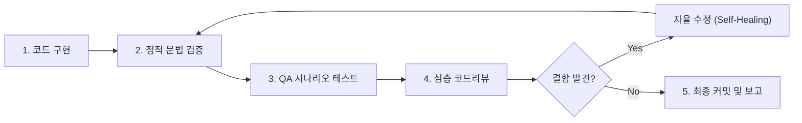

# Code Review & QA Verification Pipeline

이 스킬은 작업 공간에서 코드를 작성하거나 수정한 직후, **사용자에게 보고하기 전에 반드시 거쳐야 하는 5단계 품질 보증(QA) 및 심층 코드 리뷰 파이프라인**입니다.

---

## 🎯 핵심 목적
- 코드 변경 후 발생할 수 있는 런타임 오류, 논리적 버그, 사이드이펙트의 원천 차단
- 엣지 케이스(경계값, 빈 데이터, 잘못된 사용자 입력, 네트워크 지연 등)에 대한 선제적 방어
- API 속도 제한(Rate Limit), 메모리/성능 병목, 일관성 유지

---

## 📋 5단계 필수 검증 프로세스

### [Step 1] 정적 문법 및 린트 검증 (Syntax & Static Analysis)
- **JavaScript / Apps Script**: `node -c <file.js>` 로 AST 및 구문 무결성 100% 검증
- **Python**: `python3 -m py_compile <script.py>` 또는 flake8/black
- 미선언 변수, 오탈자, 괄호 불일치, 스코프 오염 여부 확인

### [Step 2] QA 관점 예외 및 엣지 케이스 검증 (Edge Case QA Matrix)
반드시 아래 5대 취약 포인트를 점검하고, 필요 시 Node.js/Python 검증 스크립트를 작성하여 가상 실행합니다:
1. **경계값 및 특수 케이스**:
   - `null`, `undefined`, `""`(빈 문자열), 공백만 있는 문자열
   - 날짜/시간 경계값: 자정(`00:00`), 23:59, 윤년(2/29), 월말(31일), 년도 전환(12월 ➔ 1월)
   - 잘못된 사용자 오입력 형식 (예: `26/10/11 25:00`, 불완전한 날짜 등)
2. **동시성 및 레이스 컨디션 (Race Condition)**:
   - 양방향 동기화 시 타임스탬프 미세 오차(1~3초)로 인한 무한 루프나 덮어쓰기 발생 여부
   - 시트 수정 직후 캘린더 트리거 간 충돌 방지 마진 존재 여부
3. **외부 API 및 할당량 한도 (Rate Limit & Quotas)**:
   - 단시간 연속 호출 제한(Burst limit) 방지 딜레이(`sleep`) 적용 여부
   - 불필요한 No-Op 쓰기 호출 생략(Diff Check) 여부
   - 배치 처리 시 분할(Batch Chunking) 안전 마진 적용 여부
4. **데이터 무결성 및 복구성**:
   - 빈 행, 삭제된 행, 행 순서 변경 시 고유 ID 매핑 보존 여부
   - 부분 실패 시 롤백 또는 이어하기(Resume) 가능 여부
5. **UI / 사용자 경험 일관성**:
   - 행/열 추가 시 시각적 서식, 조건부 서식, 수식 셀 오염 방지 여부

### [Step 3] 셀프 코드 리뷰 (Multi-Perspective Code Review)
개발자 본인의 관점을 벗어나 다음 3가지 관점에서 코드를 다각도 리뷰합니다:
- **시니어 아키텍트 관점**: 모듈화, 결합도, 가독성, 확장성, 중복 코드 최소화
- **보안/안정성 감사 관점**: 예외 처리(try-catch) 적절성, 민감 정보 노출 여부, 불필요한 전역 변수 최소화
- **성능/최적화 관점**: O(N^2) 비효율 루프, 불필요한 I/O 및 API 왕복 횟수 최소화

### [Step 4] 자율 수정 (Self-Healing Loop)
- QA 및 코드리뷰 단계에서 잠재적 결함이나 취약점이 발견되면, 사용자에게 질문하지 않고 **즉시 자율적으로 수정 패치를 적용**합니다.
- 수정 후 다시 Step 1부터 재검증하여 100% 통과할 때까지 반복합니다.

### [Step 5] 투명한 검증 결과 보고
- 모든 검증을 마친 후 보고서에 다음 내용을 포함합니다:
  - 🛠️ 구현 내용 요약
  - 🔍 QA 검증 결과 (테스트 시나리오 및 통과 여부)
  - 🛡️ 적용된 안전 장치 (Diff check, Rate Limit 방어, 엣지 케이스 처리)
